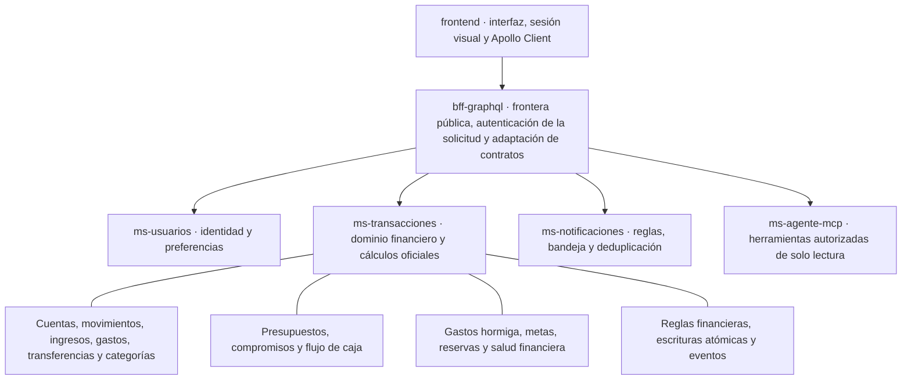

# Arquitectura de Billetera Virtual

Esta página reúne las decisiones del encargo correctivo del 25 de noviembre de 2026. La [topología](docs/TOPOLOGY.md) y el [stack](TECH_STACK.md) definen el diseño objetivo. El [modelo de dominio](docs/DOMAIN_MODEL.md), las [reglas de negocio](docs/BUSINESS_RULES.md) y los [indicadores financieros](docs/FINANCIAL_INDICATORS.md) definen los conceptos y cálculos del producto. Las [decisiones de arquitectura](docs/ARCHITECTURE_DECISIONS.md) explican las correcciones. El [plan de implementación](docs/IMPLEMENTATION_PLAN.md) registra el orden de trabajo y sus condiciones de aceptación.

## Fuentes y alcance de la revisión

El prompt correctivo fijó repositorios, tecnologías, flujos e infraestructura. Los archivos `Stack.jpeg` y `Topologia.jpeg` estaban ausentes del workspace y de los adjuntos locales examinados por nombre. La revisión cubrió los archivos versionados, las dependencias, los puntos de entrada y la capa de datos del frontend. En la consolidación se verificaron los seis remotos de aplicación y se adaptaron Compose y CI. [Registro de verificación](docs/VERIFICATION_12B.md)

## Diagnóstico del workspace

| Componente | Estado observado |
| --- | --- |
| Repositorios | Seis clones independientes con rama `main`, remotos de `Error4144` e historial extraído por componente. |
| Frontend | Aplicación React y TypeScript con Vite, Tailwind CSS, primitivas shadcn/ui, Lucide React y Recharts. La demo usa un repositorio en memoria y el modo de integración inicializa Apollo Client para `/graphql`. |
| Funcionalidades | Dashboard, Movimientos, Mis cuentas, Presupuestos, Cobros y pagos, Gastos hormiga, Metas de ahorro, Salud financiera, Asistente IA y Configuración. La aplicación comparte registros financieros y preferencias a través de adaptadores locales de sesión. |
| Backend y contratos | Cinco esqueletos con configuración por entorno. Quedan pendientes los contratos GraphQL y Protobuf, persistencia de dominio y productores y consumidores definitivos. |
| Conectividad del navegador | La revisión de la capa de datos, el punto de entrada y la configuración de Vite encontró un flujo local en memoria. Apollo queda listo para integrar cuando exista el endpoint público del BFF. |
| Entrega | Compose local con tres PostgreSQL, un broker Kafka KRaft, un perfil Nginx y comprobaciones de arranque para los cinco esqueletos. Cada clon tiene su workflow de CI preparado. Kubernetes sigue documentado como diseño objetivo. |

[Entorno local](docs/LOCAL_DEVELOPMENT.md) · [Repositorios y CI](docs/REPOSITORY_STRUCTURE.md)

## Inconsistencias y correcciones

| Impacto | Hallazgo | Corrección |
| --- | --- | --- |
| Alto | Los documentos y los README atribuían el dominio financiero a .NET y C#. | El propietario oficial es `ms-transacciones`, implementado a futuro en NestJS y TypeScript. Se conservaron las reglas de dominio y el catálogo de eventos. |
| Alto | El diagrama omitía la consulta del agente a Usuarios y el consumo Kafka de Transacciones. | Ambos flujos constan en la topología obligatoria y en la matriz de cumplimiento. |
| Alto | Los diagramas y las descripciones de alertas suponían llamadas directas desde Notificaciones a Usuarios o Finanzas. | El diseño síncrono usa exclusivamente las conexiones del prompt. La verificación de vigencia para alertas se documenta como un contrato asíncrono pendiente de cerrar con los propietarios. |
| Medio | La aplicación se construía y servía con Vite en desarrollo. Faltaban empaquetado Nginx y automatización CI. | Docker genera una imagen Nginx desde `dist`. El workflow compila, ejecuta las comprobaciones TypeScript y las pruebas, aplica el umbral unitario y valida la imagen. |
| Medio | Existían referencias históricas que podían interpretarse como contratos instalados. | Las matrices distinguen código local, dependencias instaladas, plantillas y diseño pendiente. Los contratos futuros se mantienen como propuestas. |

La búsqueda de código o proyectos en .NET, C#, ASP.NET y Entity Framework encontró referencias documentales. Tampoco se encontraron usos de NATS, RabbitMQ, REST entre el BFF y el agente, ni acceso directo del frontend a los servicios internos, datos, Kafka o LLM. Por el alcance observado, corresponde una corrección documental y de empaquetado, sin una migración de código .NET.

## Distribución de responsabilidades

Los grupos del contexto financiero se implementarán como módulos internos de NestJS en un solo servicio. Cada microservicio con persistencia tendrá su PostgreSQL y sus credenciales. Los identificadores entre contextos son referencias de contrato. El BFF fija la identidad de la solicitud y la propaga a los servicios autorizados. El agente consulta únicamente por gRPC, limita los datos enviados al proveedor HTTPS y basa sus explicaciones en los indicadores calculados por el propietario.

## Verificación de la etapa correctiva

Esta tabla conserva la evidencia histórica de la revisión de arquitectura. Los resultados del workspace multirepositorio están en el [registro de consolidación](docs/VERIFICATION_12B.md).

| Comprobación | Resultado |
| --- | --- |
| TypeScript y compilación de Vite | Aprobadas. |
| Pruebas unitarias y cobertura | 18 aprobadas. Cobertura de líneas del 93,08 % en los módulos de `src/` cargados por la suite unitaria. |
| Pruebas de navegador | 25 aprobadas en Microsoft Edge. |
| Archivos de CI y documentación | YAML y sintaxis de los comandos verificados localmente. Los enlaces internos y los 16 arcos del diagrama lógico coinciden con el inventario. La ejecución en GitHub Actions queda pendiente. |
| Lint independiente | El proyecto carece de script `lint`. CI utiliza la comprobación estática de TypeScript. |
| Docker/Nginx y Kubernetes | La imagen no pudo construirse localmente porque el daemon Docker no estaba disponible. El contexto de kubectl estaba sin configurar. |
