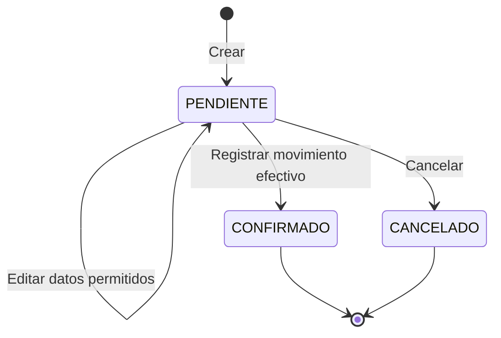

# Reglas de negocio

Los tipos y agregados se definen en el [Modelo de dominio](DOMAIN_MODEL.md). `Hoy` es la fecha local del usuario calculada una vez por operación a partir del instante del servidor y la zona horaria vigente.

## Reglas transversales

- **RN-01 — Dinero y calendario.** CLP es la única moneda inicial. Los montos de operaciones, límites y objetivos son mayores que cero. El saldo inicial y los resultados de saldo admiten cero y valores negativos. Se usa `int64` para importes de entrada y almacenamiento, con acumulación exacta de rango ampliado para agregados. gRPC usa `int64` para los campos de dominio y texto decimal canónico para totales ampliados. GraphQL, TypeScript y los eventos JSON transportan importes como texto decimal canónico para preservar precisión. Los importes de entrada fuera de rango se rechazan. Cada fecha efectiva se fija explícitamente y se conserva al cambiar la zona horaria. Las fechas de auditoría se almacenan en UTC.
- **RN-02 — Identidad y aislamiento.** El correo se compara por su representación normalizada, sin espacios iniciales ni finales y con minúsculas. La unicidad se comprueba también ante altas concurrentes. La contraseña se guarda como hash de contraseña con sal. El `usuarioId` de cada operación de usuario proviene de su identidad autenticada y se verifica en el servicio dueño. Las consultas y validaciones incluyen el propietario. Un identificador ajeno se trata como recurso inexistente. Los procesos internos requieren identidad de servicio y toman el propietario del contexto autorizado o del evento autenticado.
- **RN-03 — Reintentos y concurrencia.** Las mutaciones financieras requieren una `clave` de idempotencia estable por intención. Con `(usuarioId, operacion, clave)`, el mismo contenido normalizado devuelve la identidad y resultado original de la operación exitosa. Reusar la clave con contenido distinto produce conflicto. Solicitudes con claves distintas pueden representar operaciones legítimamente iguales. La escritura, su comprobante de idempotencia y los eventos publicables de la operación se guardan en la misma transacción. Se conservan los comprobantes mientras existan los datos del usuario en el MVP. Las escrituras financieras del mismo usuario se serializan dentro de PostgreSQL con un bloqueo transaccional por propietario, adquirido antes de leer el estado a validar. Los conflictos transitorios pueden reintentarse con la misma clave. Las consultas compuestas usan una vista consistente en la base del servicio. [Bloqueos explícitos en PostgreSQL](https://www.postgresql.org/docs/18/explicit-locking.html)

## Cuentas, movimientos y transferencias

- **RN-04 — Cuenta y movimientos efectivos.** Al crear una cuenta, su nombre debe contener texto y su fecha de apertura debe ser igual o anterior a hoy. El saldo y fecha inicial quedan fijos desde el alta. Se puede renombrar, archivar y reactivar una cuenta. Archivar exige saldo actual cero y ausencia de compromisos pendientes asociados. El historial de cuentas archivadas sigue siendo consultable. Un ingreso suma y un gasto resta a la cuenta activa asociada. Su fecha efectiva se encuentra entre la apertura y hoy, ambos inclusive. El saldo puede quedar negativo para reflejar lo registrado. La categoría activa debe ser del mismo usuario y tipo que el movimiento. Una categoría tiene nombre con texto y puede renombrarse o archivarse. Archivar una categoría con compromisos pendientes se rechaza. Las categorías archivadas conservan su uso histórico. Reclasificar un ingreso o gasto vigente en cuenta activa exige una categoría activa compatible. Se puede anular un movimiento manual conservando el registro y excluyéndolo de todos los cálculos. Una corrección de importe, fecha o cuenta se registra anulando el movimiento y creando el reemplazo como una operación independiente. Los movimientos de compromiso admiten reclasificación, incluida la marca de gasto hormiga, y conservan el vínculo con el compromiso. Su anulación individual queda fuera del MVP.
- **RN-05 — Transferencia interna.** Cuenta origen y destino distintas, activas, del mismo usuario y en la misma moneda. Fecha efectiva igual o posterior a ambas aperturas y hasta hoy. La transacción crea la transferencia y exactamente un movimiento de salida y uno de entrada, con la misma fecha y monto. La salida resta y la entrada suma. El efecto neto global es cero. Las piernas carecen de categoría y se excluyen de ingresos, gastos, presupuestos y gastos hormiga. La anulación de una transferencia exige ambas cuentas activas y excluye las dos piernas de forma atómica, conservando los registros históricos. La anulación y la reclasificación individual de una pierna se rechazan.

## Compromisos financieros

**RN-06 — Estado y vencimiento.** El alta crea un `PENDIENTE`, con cuenta y categoría activas y consistentes con el tipo. `COBRO` corresponde a `INGRESO` y `PAGO` a `GASTO`. El vencimiento debe ser igual o posterior a la apertura de esa cuenta. Puede registrarse un compromiso cuyo vencimiento ya pasó. Se considera vencido cuando su estado es `PENDIENTE` y hoy es posterior al vencimiento. El día del vencimiento se considera vigente. El vencimiento es una condición derivada y el estado almacenado sigue siendo `PENDIENTE`.

| Comando | Origen | Resultado y validación |
| --- | --- | --- |
| Crear | Recurso nuevo | `PENDIENTE`. Sin efecto en el saldo actual. |
| Editar | `PENDIENTE` | Conserva el estado y aumenta `version` si cambian datos. El tipo queda fijo. Solo se puede cambiar el vencimiento hasta el día en que vence, y el nuevo debe ser igual o posterior a hoy. Si cambian cuenta o categoría se revalidan todas las referencias y las restricciones de fecha. |
| Confirmar | `PENDIENTE` | Exige fecha efectiva explícita entre apertura y hoy. Puede ser anterior, igual o posterior al vencimiento. Usa el tipo, monto, cuenta y categoría del compromiso en la misma transacción. Cambia a `CONFIRMADO`, aumenta `version` y vincula un único movimiento vigente. |
| Cancelar | `PENDIENTE` | Cambia a `CANCELADO`, aumenta `version`, registra el instante y la fecha local de cancelación y retira el compromiso de la proyección. Conserva el saldo actual. |

**RN-07 — Idempotencia de confirmación.** `compromisoId` es único entre movimientos de origen `COMPROMISO`. Una confirmación repetida con otra clave y la misma fecha efectiva devuelve el movimiento previamente vinculado. Si la fecha difiere, se devuelve conflicto. Los reintentos con la clave original siguen RN-03. Cancelar de nuevo un compromiso ya cancelado devuelve la cancelación existente. Las demás transiciones desde estados terminales devuelven conflicto. Confirmar y cancelar en paralelo permite un solo estado terminal. La confirmación total es el único mecanismo de aplicación en el MVP.

## Presupuestos, análisis y ahorro

- **RN-08 — Presupuesto mensual.** Cada combinación de usuario, categoría de gasto y mes tiene como máximo un presupuesto. Se crea para una categoría activa y para el mes corriente o futuro. El límite de un presupuesto existente se puede cambiar hasta el cierre de su mes. Se suman únicamente gastos efectivos y vigentes asignados a su categoría durante el período. Una anulación, reclasificación o carga tardía vuelve a afectar los resultados del período correspondiente aunque esté cerrado.
- **RN-09 — Gastos hormiga.** El usuario puede configurar el monto máximo y la frecuencia mínima. Inicialmente se proponen `3000` CLP y `3` ocurrencias. Puede marcar un gasto como `NECESARIO`, `PRESCINDIBLE` o `AUTOMATICA`. La marca necesaria excluye ese gasto incluso del conteo de frecuencia. La marca prescindible se conserva explícitamente y el gasto se contabiliza como hormiga cuando satisface los criterios cuantitativos. El cálculo por categoría y mes, con la versión de preferencias aplicada, se especifica en [Indicadores financieros](FINANCIAL_INDICATORS.md#detección-de-gastos-hormiga).
- **RN-10 — Reserva de ahorro.** Crear una meta exige nombre con texto y objetivo positivo. Su objetivo queda fijo en el MVP. La reserva neta de una meta es la suma de aportes `RESERVA` menos los de `LIBERACION`. Puede reservarse hasta el menor entre la disponibilidad global positiva y el objetivo restante. Una liberación exige importe positivo hasta la reserva de la meta. Una meta alcanza `CUMPLIDA` al llegar al objetivo y vuelve a `ACTIVA` al liberar una parte. Solo se archiva con reserva cero y queda cerrada a nuevos aportes. Todo aporte cambia la reserva y el saldo disponible, conservando el saldo actual, los ingresos y los gastos. Si un registro financiero posterior reduce el saldo actual por debajo de la reserva, el saldo disponible muestra el déficit y se bloquean nuevas reservas hasta recuperar disponibilidad. El registro de operaciones reales del usuario sigue permitido.

## Alertas y asistencia

- **RN-11 — Alertas y duplicidad.** En el MVP, cada tipo tiene una regla activa por defecto. `PRESUPUESTO_UMBRAL` evalúa el mes corriente, comienza en `80 %` y admite límites del `1 %` al `100 %`. `VENCIMIENTO_PROXIMO` evalúa cobros y pagos pendientes desde hoy hasta el vencimiento inclusive, con `3` días por defecto y rango de `0` a `30`. `PAGO_VENCIDO` evalúa pagos pendientes desde el día siguiente al vencimiento. Las reglas se pueden desactivar. Un presupuesto genera a lo sumo un aviso por umbral alcanzado o superado. Cada compromiso genera a lo sumo un aviso por tipo y fecha de vencimiento. Las alertas se evalúan sobre el estado disponible al procesar y se pueden consultar en la bandeja. Marcar como leída fija el primer instante de lectura. Los avisos ya emitidos conservan su referencia histórica.
- **RN-12 — Asistencia de solo lectura.** El BFF transmite identidad autenticada al servidor MCP. Las herramientas permitidas consultan resúmenes financieros, presupuestos, proyecciones e indicadores del propio usuario. La identidad usada en cada consulta se fija del lado del servidor. La salida de las herramientas hacia el LLM usa los datos mínimos necesarios para responder. El servidor conserva el período, la moneda y la cobertura de los datos al explicar resultados. Ante datos insuficientes o una herramienta indisponible, informa la limitación y evita completar cifras por su cuenta.
