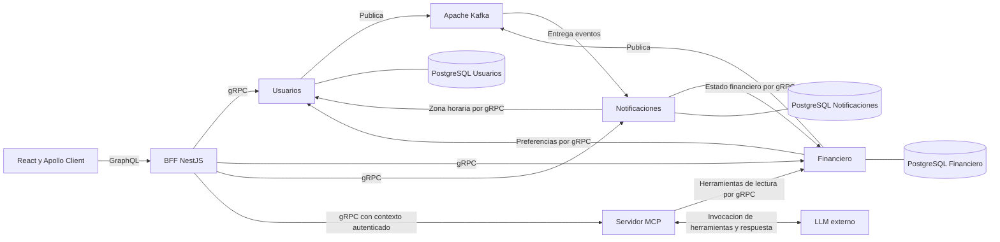
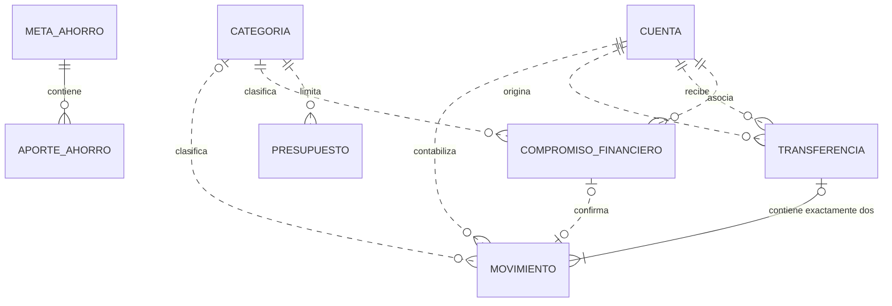

# Modelo de dominio de Billetera Virtual

Billetera Virtual organiza registros de finanzas personales. Los ingresos, gastos, transferencias y aportes reflejan operaciones que el usuario registra. La plataforma carece de funciones de custodia, liquidación y ejecución de pagos.

## Contextos delimitados

| Contexto | Dueño | Responsabilidad |
| --- | --- | --- |
| Identidad y preferencias | Usuarios, Go | Registro, autenticación, identidad, zona horaria, moneda inicial y criterios de gastos hormiga. |
| Finanzas personales | Financiero, .NET y C# | Cuentas, movimientos, clasificación, presupuestos, compromisos, metas, cálculos financieros y consultas analíticas. |
| Alertas y notificaciones | Notificaciones, Java y Spring Boot | Reglas personales de alerta, evaluación de disparadores, bandeja y deduplicación del procesamiento. |
| Asistencia financiera | Servidor MCP con LLM externo | Consulta autorizada de datos derivados y explicación de resultados. Inicialmente opera en solo lectura y carece de persistencia propia. |

React con TypeScript y Apollo Client consume el GraphQL del BFF en NestJS. Los servicios se consultan por gRPC y publican hechos de integración por Apache Kafka. Usuarios, Financiero y Notificaciones tienen cada uno su propia base PostgreSQL. Las referencias externas usan identificadores opacos y contratos de servicio. La identidad pertenece a Usuarios y los otros contextos usan su `usuarioId` como referencia de propietario. El criterio de modelado DDD aplica agregados dentro de cada contexto y referencias por identificador entre ellos. [Guía de modelado de dominio de Microsoft](https://learn.microsoft.com/en-us/dotnet/architecture/microservices/microservice-ddd-cqrs-patterns/microservice-domain-model)

## Tipos y objetos de valor

`UUID` identifica entidades. `int64` representa enteros con signo y `int32` representa cantidades como frecuencia, un porcentaje entero o un intervalo. `Instante` es un instante UTC y `FechaLocal` es una fecha calendario `AAAA-MM-DD`. `?` indica un atributo opcional. Los atributos son obligatorios salvo indicación en contrario.

| Objeto de valor | Atributos | Semántica |
| --- | --- | --- |
| `Dinero` | `importe: int64`, `moneda: CodigoMoneda` | Unidad inicial de un peso `CLP`. Cada regla determina si admite cero o signo. La aritmética y el intercambio siguen [RN-01](BUSINESS_RULES.md#reglas-transversales). |
| `MesCalendario` | `anio: int32`, `mes: int32` | Mes del 1 al 12 en la zona del usuario. Del primer día inclusivo al primer día del mes siguiente exclusivo. |
| `ZonaHoraria` | `idIana: string` | Zona IANA válida. Valor inicial propuesto `America/Santiago`. |
| `Email` | `normalizado: string` | Identificador de acceso con equivalencia definida en [RN-02](BUSINESS_RULES.md#reglas-transversales). |
| `CriterioGastoHormiga` | `montoMaximo: Dinero`, `frecuenciaMinima: int32` | Umbral inclusivo en CLP y frecuencia positiva por categoría y mes. |
| `ClasificacionGastoHormiga` | `valor: enum` | `AUTOMATICA`, `NECESARIO` o `PRESCINDIBLE`. Corresponde a la evaluación de un gasto efectivo. |
| `IdentidadDeComando` | `usuarioId: UUID`, `operacion: string`, `clave: UUID` | Identifica un reintento de escritura dentro del servicio propietario. |
| `ReferenciaAlerta` | `tipoRecurso: enum`, `recursoId: UUID`, `discriminador: string` | Identifica el presupuesto y umbral, o el compromiso y fecha de vencimiento, que motivaron un aviso. |

El saldo actual, el saldo proyectado, los gastos hormiga, las estadísticas y el indicador de salud son resultados derivados. Se calculan a partir de movimientos vigentes, compromisos, presupuestos, aportes y preferencias según corresponda. Sus contratos de consulta están en [Indicadores financieros](FINANCIAL_INDICATORS.md).

## Identidad y preferencias

| Entidad | Atributos | Agregado |
| --- | --- | --- |
| `Usuario` | `id: UUID`, `email: Email`, `hashContrasena: string`, `creadoEn: Instante` | Raíz. Garantiza la identidad y controla el cambio de preferencias. |
| `Preferencias` | `usuarioId: UUID`, `monedaBase: CodigoMoneda`, `zonaHoraria: ZonaHoraria`, `criterioGastoHormiga: CriterioGastoHormiga`, `version: int64`, `actualizadoEn: Instante` | Entidad dependiente de `Usuario` con identidad `usuarioId`. Cada usuario tiene exactamente una, creada junto con su identidad. |

## Finanzas personales

Toda entidad financiera tiene `id: UUID` y `usuarioId: UUID`. Las referencias entre registros de Finanzas conservan el mismo propietario. `creadoEn` y los demás instantes de auditoría se asignan en el servidor.

| Entidad | Otros atributos | Agregado y responsabilidad |
| --- | --- | --- |
| `Cuenta` | `nombre: string`, `moneda: CodigoMoneda`, `saldoInicial: Dinero`, `fechaApertura: FechaLocal`, `estado: ACTIVA o ARCHIVADA`, `creadoEn: Instante`, `archivadoEn?: Instante` | Raíz. Controla apertura, nombre y disponibilidad para registrar operaciones. Su saldo se deriva del saldo inicial y los movimientos. |
| `Categoria` | `nombre: string`, `tipo: INGRESO o GASTO`, `estado: ACTIVA o ARCHIVADA`, `creadoEn: Instante` | Raíz. Define una clasificación del usuario. El tipo permanece fijo. |
| `Movimiento` | `cuentaId: UUID`, `tipo: INGRESO, GASTO, TRANSFERENCIA_SALIDA o TRANSFERENCIA_ENTRADA`, `monto: Dinero`, `fechaEfectiva: FechaLocal`, `categoriaId?: UUID`, `clasificacionHormiga?: ClasificacionGastoHormiga`, `origen: MANUAL, COMPROMISO o TRANSFERENCIA`, `compromisoId?: UUID`, `transferenciaId?: UUID`, `anuladoEn?: Instante`, `creadoEn: Instante` | Entidad con identidad propia. Es raíz para registros manuales y de compromiso. Los dos movimientos de una transferencia son entidades internas de `Transferencia`. El origen determina las referencias válidas y las operaciones permitidas. |
| `Transferencia` | `cuentaOrigenId: UUID`, `cuentaDestinoId: UUID`, `monto: Dinero`, `fechaEfectiva: FechaLocal`, `creadoEn: Instante`, `anuladoEn?: Instante` | Raíz. Crea y anula exactamente dos movimientos de sentido opuesto. |
| `Presupuesto` | `categoriaId: UUID`, `periodo: MesCalendario`, `limite: Dinero`, `creadoEn: Instante`, `actualizadoEn: Instante` | Raíz. Mantiene un límite por categoría de gasto y mes. Su consumo se calcula con movimientos vigentes. |
| `CompromisoFinanciero` | `tipo: COBRO o PAGO`, `cuentaId: UUID`, `categoriaId: UUID`, `monto: Dinero`, `fechaVencimiento: FechaLocal`, `estado: PENDIENTE, CONFIRMADO o CANCELADO`, `version: int64`, `creadoEn: Instante`, `confirmadoEn?: Instante`, `canceladoEn?: Instante`, `fechaCancelacion?: FechaLocal` | Raíz. Mantiene la expectativa de cobro o pago. La confirmación vincula un único movimiento efectivo por su `compromisoId`. La fecha local de cancelación queda fijada al cancelar. |
| `MetaAhorro` | `nombre: string`, `montoObjetivo: Dinero`, `estado: ACTIVA, CUMPLIDA o ARCHIVADA`, `creadoEn: Instante`, `archivadoEn?: Instante` | Raíz. Mantiene la reserva neta mediante aportes. |
| `AporteAhorro` | `metaId: UUID`, `tipo: RESERVA o LIBERACION`, `monto: Dinero`, `creadoEn: Instante` | Entidad inmutable del agregado `MetaAhorro`. Registra una variación de la reserva global. |

La cardinalidad de `Transferencia` a `Movimiento` se restringe a exactamente dos por [RN-05](BUSINESS_RULES.md#cuentas-movimientos-y-transferencias). Cada movimiento de origen `COMPROMISO` exige un compromiso y cada compromiso confirmado exige exactamente un movimiento. `categoriaId` es obligatorio para ingresos y gastos y queda vacío para las dos piernas de transferencia. `clasificacionHormiga` existe para gastos y comienza como `AUTOMATICA`. Cada presupuesto pertenece a una categoría de gasto. Una meta puede contener cero o más aportes. Cada usuario tiene de cero a muchos registros de cada raíz financiera.

La coordinación entre raíces ocurre dentro de Financiero. Este servicio confirma un compromiso y su movimiento, o registra una transferencia y sus movimientos, en una única transacción de su base. El registro y la liberación de aportes coordinan la meta y la disponibilidad global del mismo usuario. El detalle de las transiciones y concurrencia está en [Reglas de negocio](BUSINESS_RULES.md).

## Alertas y notificaciones

| Entidad | Atributos | Agregado o rol |
| --- | --- | --- |
| `ReglaAlerta` | `id: UUID`, `usuarioId: UUID`, `tipo: PRESUPUESTO_UMBRAL, VENCIMIENTO_PROXIMO o PAGO_VENCIDO`, `activa: bool`, `umbralPorcentaje?: int32`, `diasAnticipacion?: int32`, `actualizadoEn: Instante` | Raíz. Existe como máximo una regla persistida por usuario y tipo. Los valores predeterminados se aplican hasta su primera personalización. |
| `Notificacion` | `id: UUID`, `usuarioId: UUID`, `tipo: enum de alerta`, `referencia: ReferenciaAlerta`, `claveDeduplicacion: string`, `creadoEn: Instante`, `leidoEn?: Instante` | Raíz. `leidoEn` determina si está leída. Se genera desde una evaluación de la regla en Notificaciones. |
| `EventoProcesado` | `consumidor: string`, `eventoId: UUID`, `usuarioId: UUID`, `procesadoEn: Instante` | Entidad técnica de recepción, con identidad compuesta por `(consumidor, eventoId)`. Garantiza que la aplicación de un evento pueda repetirse sin duplicar sus efectos. |

Cada usuario tiene cero a muchas notificaciones. Una regla puede originar cero a muchas notificaciones. Cada aviso conserva el tipo y su referencia en el momento de la evaluación, incluso tras personalizar la regla. Un evento puede provocar cero o varias evaluaciones de alerta, y una alerta programada puede originarse sin evento. La semántica de deduplicación está en [RN-11](BUSINESS_RULES.md#alertas-y-asistencia).
