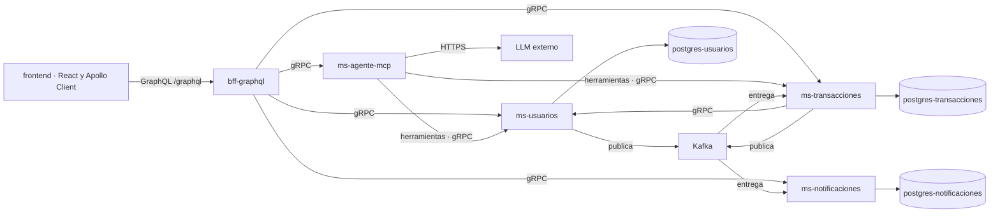
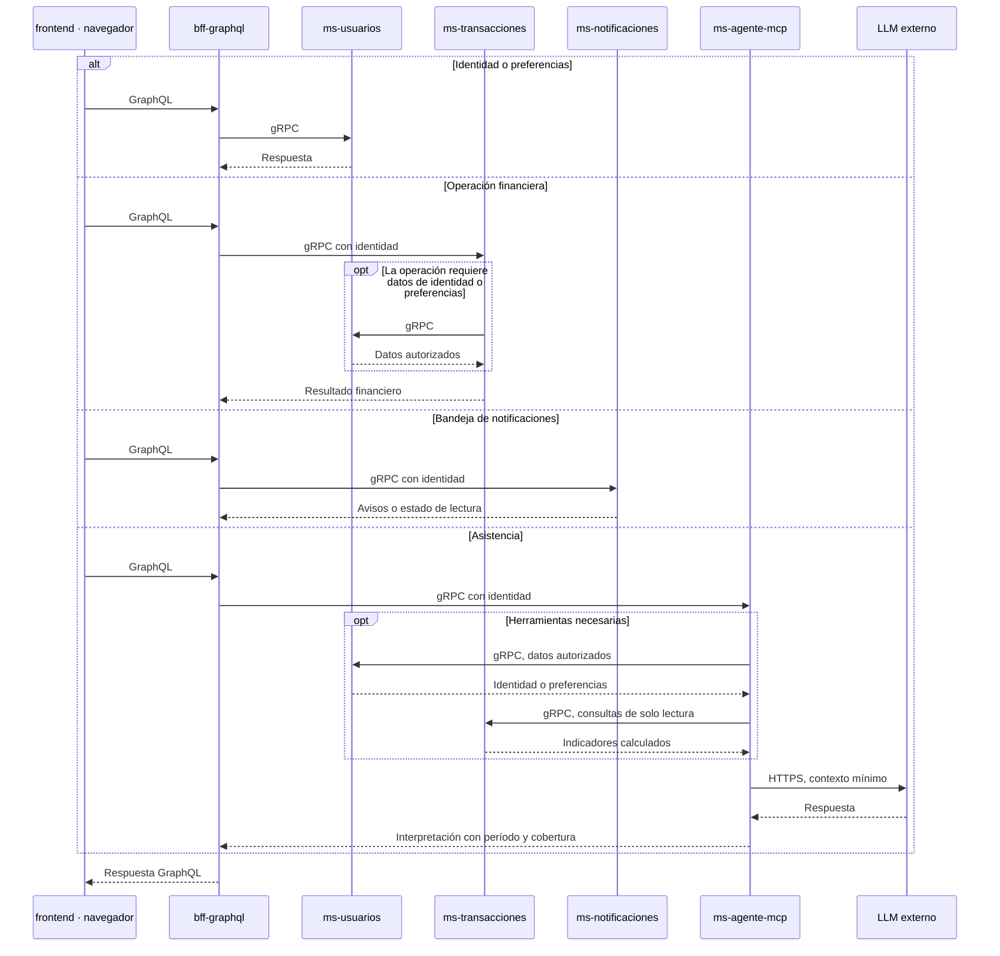
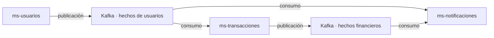
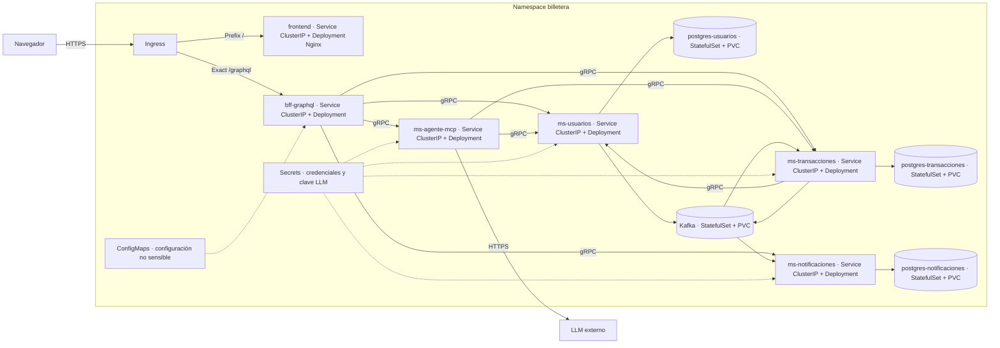

# Topología oficial

La aplicación React se descarga desde Nginx. El cliente Apollo en el navegador usa el BFF como única entrada a datos del sistema. Las flechas describen orígenes y destinos de las solicitudes o entregas, con sus respuestas implícitas. Este documento describe el diseño objetivo. La [matriz de cumplimiento](#matriz-de-cumplimiento) registra qué se observó en el workspace.

## Topología lógica

## Comunicación síncrona

El BFF actúa como servidor GraphQL y cliente gRPC. El agente implementa gRPC para la comunicación con el BFF y usa el SDK MCP para sus herramientas. La identidad del usuario proviene del contexto autenticado del servidor. Los contratos de errores, tiempos máximos e idempotencia deberán acordarse en la implementación.

## Comunicación asíncrona

La topología permite que Transacciones consuma eventos de usuarios. La asignación por tópico, filtrado, versionado y recuperación quedan documentados en el [catálogo de eventos](DOMAIN_EVENTS.md). Para RN-11, la vigencia financiera se obtiene de observaciones producidas por el dueño de los datos y entregadas por Kafka. El contrato de observación y su frescura aún requieren una decisión de diseño. [Decisiones de arquitectura](ARCHITECTURE_DECISIONS.md#adr-04-eventos-y-evaluación-de-alertas)

## Despliegue objetivo en Kubernetes

| Recurso | Diseño previsto |
| --- | --- |
| Namespace | `billetera` contiene los componentes de la aplicación y sus recursos internos. |
| `frontend` | Deployment de Nginx con artefactos estáticos y Service ClusterIP. La imagen propuesta escucha en 8080 y expone `/healthz`. |
| `bff-graphql` | Deployment y Service ClusterIP HTTP para GraphQL. Los destinos internos se resuelven por Service de Kubernetes. |
| Cuatro servicios internos | Un Deployment y un Service ClusterIP por servicio con gRPC. Los Services se alcanzan dentro del clúster. |
| PostgreSQL | Tres StatefulSets independientes con PVC y Services internos para sus dueños. Credenciales separadas y referencias externas por identificador. |
| Kafka | StatefulSet, almacenamiento persistente por broker mediante PVC y Service interno. La cantidad de réplicas y la política de operación quedan por definir. |
| Ingress | TLS en un mismo host. `/graphql` de tipo `Exact` al BFF y `/` de tipo `Prefix` a Nginx. Se conserva la ruta recibida por el BFF. |
| ConfigMaps | Configuración no sensible, como direcciones internas, puertos, nivel de logs y nombres de tópicos acordados. |
| Secrets | Credenciales de cada PostgreSQL y clave del proveedor LLM entregadas al workload correspondiente por el mecanismo del entorno. Los valores reales se administran fuera de Git. |

Los puertos internos de los servicios, las imágenes, el controlador Ingress, el almacenamiento, los probes de backend y las políticas de red se definen cuando exista un entorno de despliegue. El diagrama describe recursos futuros. [Ingress en Kubernetes](https://kubernetes.io/docs/concepts/services-networking/ingress/) · [StatefulSets y almacenamiento](https://kubernetes.io/docs/concepts/workloads/controllers/statefulset/)

El entorno local define los puertos de desarrollo y redes aisladas de PostgreSQL y Kafka. Publica únicamente Nginx por loopback. Los cinco esqueletos están preparados para configurar las conexiones aprobadas en esta topología. [Compose, puertos y redes locales](LOCAL_DEVELOPMENT.md#puertos-y-redes)

## Matriz de cumplimiento

| Origen | Destino | Protocolo o sentido | Estado observado |
| --- | --- | --- | --- |
| `frontend` | `bff-graphql` | GraphQL | Apollo Client preparado en modo de integración con `/graphql`. Esquema, sesión y operaciones remotas pendientes. La demo usa memoria. |
| `bff-graphql` | `ms-usuarios` | gRPC | Diseño. Implementación y contrato pendientes. |
| `bff-graphql` | `ms-transacciones` | gRPC | Diseño. Implementación y contrato pendientes. |
| `bff-graphql` | `ms-notificaciones` | gRPC | Diseño. Implementación y contrato pendientes. |
| `bff-graphql` | `ms-agente-mcp` | gRPC | Diseño. Implementación y contrato pendientes. |
| `ms-transacciones` | `ms-usuarios` | gRPC | Diseño. Implementación y contrato pendientes. |
| `ms-agente-mcp` | `ms-usuarios` | Herramientas mediante gRPC | Diseño. Implementación y autorización pendientes. |
| `ms-agente-mcp` | `ms-transacciones` | Herramientas mediante gRPC | Diseño. Implementación y autorización pendientes. |
| `ms-agente-mcp` | LLM externo | HTTPS | Diseño. Proveedor e integración pendientes. |
| `ms-usuarios` | Kafka | Publicación | Diseño y catálogo. Productor pendiente. |
| `ms-transacciones` | Kafka | Publicación | Diseño y catálogo. Productor pendiente. |
| Kafka | `ms-transacciones` | Consumo | Diseño. Consumidor y suscripciones pendientes. |
| Kafka | `ms-notificaciones` | Consumo | Diseño y catálogo. Consumidor pendiente. |
| Usuarios, Transacciones y Notificaciones | PostgreSQL de cada propietario | Acceso local del servicio | Instancias separadas en Compose. Conexión de los servicios y migraciones pendientes. |
| Navegador | Servicios internos, Kafka, bases y LLM | Acceso directo fuera de la topología | Sin conexiones observadas. Aislamiento de red del despliegue pendiente. |
| `ms-notificaciones` | Servicios de dominio | Llamadas directas fuera de la topología | Diagrama corregido. Las observaciones de vigencia quedan pendientes por Kafka. |
| Ingress | Frontend y BFF | HTTP interno mediante Services | Rutas documentadas. Ingress y clúster pendientes. |
