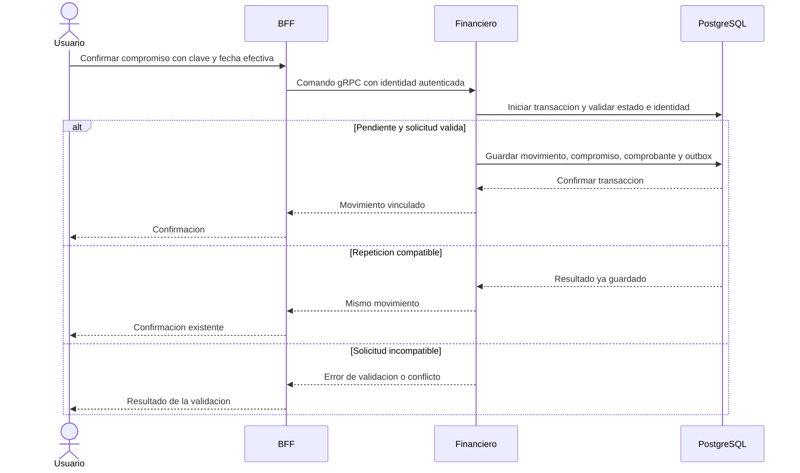

# Casos de uso por servicio

El usuario inicia los comandos y consultas desde el BFF. En las tablas, la aceptación se valida según [Requisitos funcionales](FUNCTIONAL_REQUIREMENTS.md) y los comportamientos se rigen por las [Reglas de negocio](BUSINESS_RULES.md). Las escrituras financieras comparten el contrato de idempotencia RN-03.

## Usuarios · Go

| ID y caso | Actor y precondición | Flujo y resultado | Alternativas | Requisito |
| --- | --- | --- | --- | --- |
| CU-U01 · Registrar usuario | Visitante con correo y contraseña. | Normalizar correo, validar credenciales de alta y guardar usuario, preferencias iniciales y `UsuarioRegistrado` en la misma transacción. | Correo inválido, política de contraseña incumplida o identidad existente. Se rechaza el alta. | RF-01 |
| CU-U02 · Iniciar o cerrar sesión | Visitante para iniciar. Usuario autenticado para cerrar. | Verificar credenciales, crear sesión asociada a la identidad y permitir las operaciones de usuario. Cerrar invalida la sesión. | Credenciales inválidas deniegan acceso. Cerrar una sesión ya cerrada conserva su estado. | RF-01, RT-01 |
| CU-U03 · Consultar o cambiar preferencias | Usuario autenticado. Lector interno autorizado cuando se solicitan los campos necesarios. | Consultar zona, moneda y criterio. Al guardar un cambio válido, incrementar la versión y guardar `PreferenciasActualizadas`. | Rechazar zona, monto o frecuencia inválidos y cambios de moneda fuera de CLP. Una escritura con valores iguales conserva la versión. | RF-01, RF-08 |

## Financiero · .NET y C#

| ID y caso | Actor y precondición | Flujo y resultado | Alternativas | Requisito |
| --- | --- | --- | --- | --- |
| CU-F01 · Administrar cuentas | Usuario autenticado. | Abrir con saldo y fecha declarados, consultar por identidad, renombrar, archivar o reactivar. Devolver estado y saldo calculado. | Rechazar apertura futura y archivo con saldo distinto de cero o compromisos pendientes. | RF-02 |
| CU-F02 · Administrar categorías | Usuario autenticado. | Crear categoría de ingreso o gasto, consultar y renombrar o archivar manteniendo referencias históricas. | Rechazar archivo con compromisos pendientes, tipo inválido o nombre vacío. | RF-04 |
| CU-F03 · Gestionar movimientos efectivos | Usuario autenticado con cuenta activa y categoría compatible al alta. | Registrar ingreso o gasto, consultar historial filtrado, cambiar categoría vigente o anular un movimiento manual. Recalcular saldos y consumos aplicables con estados vigentes. | Fecha, monto o referencias inválidas rechazan la operación. Anular un movimiento de compromiso o transferencia individualmente produce conflicto. | RF-03, RF-04, RF-05, RF-09 |
| CU-F04 · Registrar o anular transferencia | Usuario autenticado con dos cuentas propias activas. | Validar fecha, moneda y monto. Registrar y consultar la transferencia con ambas piernas, o anular ambas en bloque. | Ante fallo de cualquiera de las dos piernas, revertir toda la operación. Rechazar cuentas iguales o referencias ajenas. | RF-03, RF-09, RT-02 |
| CU-F05 · Gestionar y consultar presupuestos | Usuario autenticado y categoría de gasto activa al alta. | Crear un límite por mes y categoría, actualizar el límite permitido y consultar el consumo real con su corte. | Rechazar duplicados y cambios sobre meses cerrados. Un período futuro tiene consumo inicial cero. | RF-05 |
| CU-F06 · Crear, consultar o editar compromiso | Usuario autenticado con cuenta y categoría activas al alta. | Registrar un pendiente, consultar por rango o estado y editar datos permitidos. Informar vencimiento calculado en la zona del usuario. | Rechazar tipo incompatible, fecha anterior a apertura y cambios de vencimiento fuera del plazo. | RF-06 |
| CU-F07 · Confirmar o cancelar compromiso | Usuario autenticado y compromiso propio. | Confirmar con fecha efectiva explícita. Guardar cambio de estado, movimiento, idempotencia y hechos de integración juntos. Cancelar conserva el saldo y retira la partida proyectada. | Consultar la resolución existente ante repetición compatible. Rechazar transiciones terminales incompatibles y fechas inválidas. | RF-06, RF-07, RT-02 |
| CU-F08 · Consultar proyección | Usuario autenticado con horizonte desde hoy. | Partir del saldo actual, distribuir los pendientes por fecha proyectada y devolver saldo y disponible de cada fecha. | Un horizonte anterior a hoy se rechaza. Sin pendientes, la serie conserva su saldo inicial. | RF-07 |
| CU-F09 · Consultar y clasificar gastos hormiga | Usuario autenticado. Para marcar, gasto efectivo vigente en cuenta activa. | Guardar la marca y consultar por mes con la versión vigente de umbrales. Devolver grupos elegibles y totales. | Rechazar marcas sobre ingresos y transferencias. Una marca necesaria deja el gasto fuera del análisis hormiga. | RF-08 |
| CU-F10 · Consultar estadísticas, saldo y salud financiera | Usuario autenticado o herramienta con alcance de lectura autorizado. | Calcular series, totales y desgloses por rango, o calcular salud para el mes cerrado solicitado. Informar versión, fechas y cobertura cuando apliquen. | Rango invertido o futuro en estadísticas se rechaza. Para salud, un mes abierto o sin cobertura suficiente produce resultado sin puntuación. | RF-09, RF-11, RF-13 |
| CU-F11 · Administrar una meta de ahorro | Usuario autenticado. | Crear, consultar o archivar una meta y registrar una reserva o liberación atómica con su nuevo saldo disponible. | Rechazar reserva superior al disponible u objetivo restante, liberación mayor a la reserva y archivo con reserva pendiente. | RF-10 |
| CU-F12 · Proveer estado para evaluar alertas | Notificaciones con identidad interna autorizada. | Consultar presupuestos o compromisos por referencia y propietario. Para evaluación programada, devolver candidatos paginados con las referencias y el estado necesario. | Rechazar llamadas sin permiso de servicio y referencias que no correspondan al propietario. | RF-12, RT-01, RT-03 |

### Confirmación idempotente

## Notificaciones · Java y Spring Boot

| ID y caso | Actor y precondición | Flujo y resultado | Alternativas | Requisito |
| --- | --- | --- | --- | --- |
| CU-N01 · Consultar y ajustar reglas | Usuario autenticado. | Consultar configuración efectiva, activar o desactivar reglas y validar parámetros por tipo. | Valores fuera de intervalo se rechazan. El cambio se recoge en la siguiente evaluación o antes. | RF-12 |
| CU-N02 · Evaluar eventos y condiciones del calendario | Consumidor Kafka o proceso programado autorizado. | Validar evento o lote, consultar estado vigente y zona, aplicar reglas y deduplicar los avisos. Registrar evento procesado y avisos en una transacción local al consumir Kafka. | Si el evento o la clave de alerta ya existen, se omite el efecto repetido. Ante fallo transitorio se reintenta. | RF-12, RT-01, RT-03 |
| CU-N03 · Consultar avisos o marcarlos como leídos | Usuario autenticado. | Listar sus avisos con referencia y estado de lectura. Registrar la primera lectura al solicitarlo. | Una segunda marca conserva la primera fecha. Una referencia ajena se trata como inexistente. | RF-12, RT-01 |

## BFF · NestJS y GraphQL

| ID y caso | Actor y precondición | Flujo y resultado | Alternativas | Requisito |
| --- | --- | --- | --- | --- |
| CU-B01 · Exponer operaciones al cliente | Cliente React. Alta y acceso público, operaciones personales con sesión válida. | Validar sesión y formato de entrada, traducir la solicitud GraphQL a los servicios por gRPC, propagar identidad, correlación y clave cuando aplique y devolver el resultado. | Exponer validaciones y conflictos con semántica estable. Una sesión inválida se rechaza antes de acceder a registros personales. | RF-01 a RF-13, RT-01 a RT-03 |

## Servidor MCP con LLM externo

| ID y caso | Actor y precondición | Flujo y resultado | Alternativas | Requisito |
| --- | --- | --- | --- | --- |
| CU-M01 · Interpretar datos financieros propios | Usuario autenticado mediante el BFF. | Determinar período, invocar una herramienta autorizada bajo la identidad fijada por el servidor y explicar el resultado con su moneda, fecha o período y cobertura. | Una petición fuera de alcance no ejecuta escritura. Si falla la consulta o faltan datos, el resultado indica la limitación. | RF-13, RT-01 |

El catálogo inicial de herramientas comprende consultas de resumen de ingresos, gastos y saldo, consumo presupuestario, proyección, gastos hormiga y salud financiera. Sus argumentos son filtros y períodos de consulta. La identidad se deriva de la sesión en la capa de aplicación y se aplica a todas las llamadas a Financiero.
